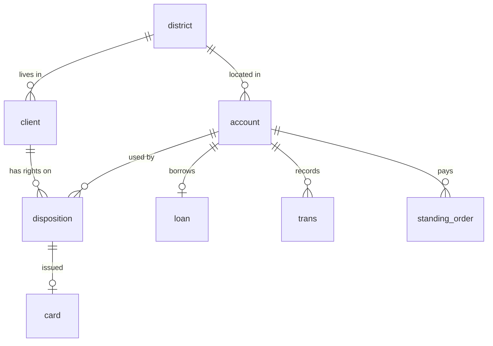

# Part 2: Relational Data Model — Retail Credit Risk Scoring (Berka data)

## 1. Overview

The new version replaces the synthetic database of the previous version with the **Berka / PKDD'99 Czech bank dataset**: real,
anonymised data from one bank covering 1993-01-01 to 1998-12-31. It is loaded into PostgreSQL schema
`berka` by `scripts/berka/load_berka.js`, with Czech codes translated to English.

Source: `http://lisp.vse.cz/pkdd99/DATA/data_berka.zip` (also published on Kaggle as
"The Berka Dataset").

The model has two layers:

- **Source tables (8)** — the bank's data as received.
- **Scorecard tables** — features, learned constants, scores and validation, all derived from the source.

## 2. Source tables

| Table | Rows | Key | Holds |
|---|---|---|---|
| `district` | 77 | district_id | region demographics: inhabitants, average salary, unemployment '95/'96, entrepreneurs, crimes |
| `account` | 4,500 | account_id | district, statement frequency (monthly 4,167 / weekly 240 / after each transaction 93), open date |
| `client` | 5,369 | client_id | birth date, gender (decoded from the birth number), district |
| `disposition` | 5,369 | disp_id | links clients to accounts: OWNER (4,500) or DISPONENT, a second user (869) |
| `card` | 892 | card_id | card type (junior / classic / gold) and issue date, per disposition |
| `loan` | 682 | loan_id | one per account at most: date, amount, duration, monthly payment, status A/B/C/D, `is_bad` |
| `trans` | 1,056,320 | trans_id | every transaction: date, credit/withdrawal, operation, amount, balance after, purpose (`k_symbol`), partner bank/account |
| `standing_order` | 6,471 | order_id | permanent payment orders: recipient, amount, purpose |

Relationships:

Loan status: A = finished, paid; B = finished, not paid; C = running, on time; D = running, in debt.
`is_bad` = B or D (76 loans, 11.1%).

## 3. Scorecard tables

| Table / view | One row per | Built by | Holds |
|---|---|---|---|
| `loan_features` | loan | `10_features.sql` | 14 candidate metrics from the 12 months before the loan date; train/test split |
| `metric_evidence` | candidate metric | `fit_scorecard.js` | Gini, default rate per value group, kept/dropped and why |
| `metric_correlation` | pair of metrics | `fit_scorecard.js` | Spearman rank correlation |
| `scorecard_band` | metric × band | `fit_scorecard.js` | value range → points, default rate, training count |
| `scorecard_weight` | kept metric | `fit_scorecard.js` | regression coefficient, weight, missing-value band |
| `criterion_weight` | criterion | `fit_scorecard.js` | sum of its metrics' weights |
| `scorecard_param` | setting | `fit_scorecard.js` | grade cut-offs, approve line, shrinkage k, training Gini |
| `loan_metric_points` | loan × kept metric | `20_score.sql` | raw value, band, points |
| `loan_score` | loan | `20_score.sql` | criterion points, score 0–100, grade, approved |
| `validation_*` views | split / grade | `30_validate.sql` | Gini, approval, default rate by grade, robustness checks |

## 4. How each feature is derived

| Feature | Source | Definition (12-month window before the loan) |
|---|---|---|
| Overdraft events | trans.balance | transactions leaving a negative balance |
| Penalty-interest charges | trans.k_symbol | transactions with purpose `penalty_interest` |
| Loan payment ÷ monthly income | loan, trans | monthly payment ÷ (credits ÷ months elapsed) |
| Income sources | trans | distinct partner accounts sending incoming transfers |
| Monthly money in | trans | credits ÷ months elapsed in the window |
| Balance volatility | trans.balance | std. deviation ÷ mean of month-end balances |
| Lowest balance | trans.balance | minimum balance in the window |
| Balance trend | trans.balance | slope of month-end balance per month ÷ mean balance |
| Spend ÷ income | trans | withdrawals ÷ credits |
| Account age | account.open_date | months from opening to loan date |
| Has a card | card, disposition | owner's card issued **before** the loan date |
| Joint account | disposition | account has a second user (DISPONENT) |
| Age | client.birth_date | owner's age at loan date |
| District unemployment | district | owner's district, 1996 rate (1995 if missing) |

## 5. Change from the previous version

The previous version used a 13-table model designed for the assignment and filled by a data generator. Because the
generator created behaviour from risk levels we chose, the data could not show whether a metric really
predicts default. The new version keeps the same idea — bank data feeding a scorecard — on real data with known
outcomes. The previous schema, generator and scripts are kept in `archive/previous_version/`.
